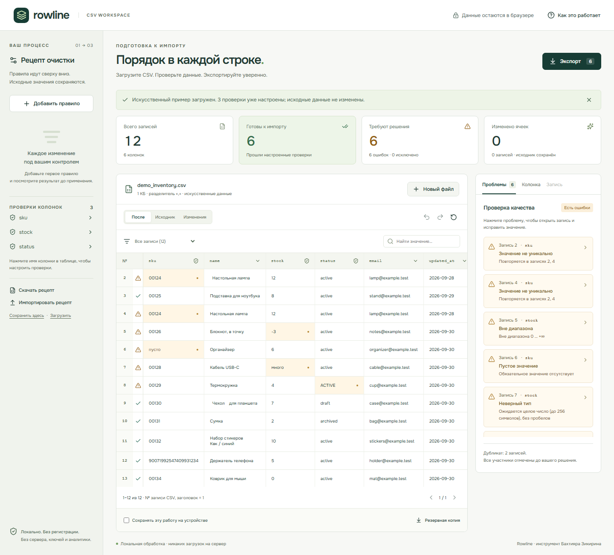

# Rowline

**CSV, готовый к импорту.** Локальная рабочая среда для очистки и проверки данных, созданная Бахтияром Зикириным.

[Открыть приложение](https://moyisey.github.io/rowline/) · [Исходный код](https://github.com/MOYISEY/rowline)

Rowline помогает разобрать экспорт перед загрузкой в каталог, CRM или другую систему: обнаружить неверные значения, осознанно решить конфликт дубликатов и получить проверяемый результат. Это работающий инструмент, без сервера, регистрации, платных API и аналитики.



[Мобильный экран с реального live](media/rowline-mobile.png) · [Проверки и независимые аудиты](QA.md)

## Рабочий процесс

1. Загрузите `.csv`, `.tsv` или `.txt`, перетащите файл или вставьте текст. Первая запись — уникальные непустые имена колонок. Можно открыть явно обозначенный искусственный пример: 12 товаров и 6 ошибок.
2. Выберите заголовок колонки и задайте обязательность, уникальность, тип, диапазон или список допустимых значений.
3. Добавьте правило очистки: сначала показаны эффект, первые изменения и число готовых/отклонённых записей. Правила выполняются по порядку, отключаются, перемещаются и удаляются.
4. Нажмите проблему, чтобы перейти к её записи и ячейке. Исправьте значение, выберите участника дубликата или исключите запись с причиной. Все участники дубликата отмечены ошибкой, пока решение не принято.
5. Скачайте готовые записи, отклонённые строки, отчёт и рецепт. Очищенный CSV содержит только записи без ошибок настроенных проверок. В окне экспорта видно, куда попадёт каждая запись.

### Вход и выход

| Файл | Содержимое |
| --- | --- |
| `*_clean.csv` | Оригинальные заголовки и очищенные значения только готовых записей, в исходном порядке |
| `*_rejected.csv` | Номер исходной логической записи CSV, причины, **полная исходная запись в JSON**, очищенные значения известных колонок; лишние ячейки не теряются |
| `*_report.json` | Сводка, требования, номера отклонённых записей/ошибок, колонки изменений и ручных исправлений, параметры экспорта |
| `*_recipe.json` | Упорядоченные правила и проверки, без строк CSV, исключений и ручных правок |
| `*_workspace.json` | Резервная копия исходных данных, рецепта, ручных правок и исключений; без истории Undo |

Рецепт применяется к другому файлу с теми же именами колонок, даже если порядок отличается. Недостающие колонки перечисляются, применение отменяется. Дополнительные колонки допустимы; правила «Все колонки» затрагивают их тоже. Имена и уникальные значения сравниваются точно, с учётом регистра и пробелов.

### Возможности

- Разбор CSV через **Papa Parse**: UTF-8/BOM, Windows-1251 при явном выборе, CRLF/LF, запятая, `;`, табуляция, `|`, экранированные кавычки, разделители и переносы внутри кавычек.
- Значения остаются строками: `00124`, большие числовые ID и даты не преобразуются автоматически. Десятичные границы сравниваются точно через BigInt, без потери точности Number.
- Обратимые правила: trim, сжатие пробельных символов, верхний/нижний регистр, точная замена всего значения, заполнение пустого, исключение пустых записей.
- Проверки: обязательность, уникальность, целое/десятичное число с точкой и min/max, существующая дата `YYYY-MM-DD`, базовый синтаксис email, явные допустимые значения.
- Ручные исправления идут **после правил**. Undo/redo — до 50 действий; сброс также отменяется. Ctrl+Z / Ctrl+Shift+Z работают вне полей ввода.
- Фильтры, поиск, исходные/очищенные значения и сравнение изменений. Таблица показывает 20 записей на странице.
- Выбор разделителя, BOM и CRLF/LF для экспорта. Excel RU обычно использует `;`, Excel EN — запятую, но настройки Excel/ОС могут отличаться.
- Неоднозначные кавычки, повторные/пустые заголовки останавливают импорт и сохраняют текущую работу. Несовпавшая ширина записи сохраняется полностью и попадает в отклонённые.

## Приватность и безопасность

CSV обрабатывается в Web Worker браузера. **Приложение не отправляет данные по сети**, не содержит telemetry, cookies, внешних шрифтов, runtime CDN или backend. GitHub Pages получает обычные запросы статических ресурсов; политика хостинга относится к инфраструктуре, а не к отправке CSV приложением.

По умолчанию данные живут только в памяти вкладки. «Сохранять эту работу на устройстве» — отдельное добровольное действие для текущего файла: исходник и правки помещаются в localStorage данного браузера/сайта. При выключении сохранение удаляется. Новый импорт не включает сохранение автоматически. Ошибка/переполнение хранилища не уничтожает текущие данные. JSON-копия позволяет восстановиться вручную.

Рецепт можно сохранить отдельно на устройстве. Он не содержит строки исходного файла, но **значения замен/заполнения и разрешённые значения могут быть чувствительными**. Резервная копия и отклонённые файлы содержат ваши данные; не публикуйте их без необходимости.

React выводит недоверенные значения как текст, без `innerHTML`. JSON-рецепты проходят ограниченную схему с allowlist действий/полей, лимитами и проверками колонок; нет `eval`, пользовательских выражений и RegExp. Резервные копии проверяются до восстановления. CSP запрещает внешние скрипты, объекты и формы.

**Защита CSV от формул включена по умолчанию.** Перед потенциальной формулой (`=`, `+`, `-`, `@`, табуляция/CR/LF, включая начальные пробелы) ставится апостроф. Защищаются также заголовки и отклонённые значения. Это намеренно **изменяет значение**, в том числе отрицательное число. В окне экспорта показано количество защищаемых ячеек очищенного CSV и есть явное отключение для точного переноса в доверенную систему. Для round-trip неизменных значений выключите защиту, если ваши данные этого требуют. Кавычки CSV сами по себе не предотвращают выполнение формулы в электронных таблицах.

## Практические ограничения

- Вход: **2 МБ**, **10 000 записей**, **100 колонок**, **500 000 ячеек**; имя колонки до 256 символов; до 100 правил. Это предел, а не обещание одинаковой скорости на любом устройстве.
- Очищенные значения: до **8 МБ**; значение правила и ручная правка — до **10 000 символов**. Рецепт JSON до 256 КБ, резервная копия до 8 МБ. Если правило чрезмерно расширяет данные, экспорт блокируется до исправления/отмены.
- Номер записи — логическая запись CSV: заголовок №1, данные с №2. Перенос внутри кавычек не увеличивает номер; это **не физическая строка файла**.
- Поддерживаются текстовые UTF-8 и Windows-1251; не XLS/XLSX, UTF-16, архивы или произвольные кодировки. Автоопределение разделителя эвристическое: проверьте его в имени файла или задайте вручную.
- Рецепты требуют точных имён колонок. Уникальность точная; если нужно игнорировать регистр/пробелы, добавьте соответствующие правила явно.
- Числа: до 256 символов, десятичная точка, без экспонент, разделителей тысяч и десятичной запятой. Дата только `YYYY-MM-DD`. Email — синтаксис, без проверки существования/доставки.
- Проверки не определяются автоматически для собственных файлов. «Готово» означает прохождение **заданных** требований и структурных проверок; это не универсальная гарантия совместимости с любой внешней системой.
- Повреждённые кавычки и заголовки исправляются в исходном CSV. Строки с неверным числом ячеек нельзя вручную расширять/сужать в таблице; они полностью сохраняются в отклонённых для внешней корректировки.
- Ручные изменения/исключения не переносятся рецептом. Undo не переносится через перезагрузку/backup.
- RU-интерфейс; английская локализация пока отсутствует. WebKit в тестах — движок Playwright, не Safari; мобильный viewport — эмуляция, не физический телефон.

## Архитектура

React + TypeScript + Vite, Papa Parse для parsing/unparsing, Lucide для UI и локальный Onest для шрифта. Статический сайт на GitHub Pages, никакого приложения на сервере.

```
src/core.ts     Чистые функции: parsing → ordered transforms → final edits → validation → exports
src/worker.ts   Parsing и pipeline в отдельном потоке
src/main.tsx    UI, действия, bounded undo/redo, добровольное сохранение и recovery
src/style.css  Адаптивная сетка, keyboard/focus/reduced-motion стили
tests/         Node unit tests и Playwright acceptance / accessibility / export tests
docs/          Собранный статический сайт для бесплатного GitHub Pages
```

Исходные массивы не мутируются. Готовые и отклонённые записи образуют полное разбиение исходных записей. Ошибки структурных строк не маскируются правилами. Превью и итог используют один pipeline. Количество исходных записей не меняется даже при исключении пустых записей: они остаются в rejected.

## Запуск и проверки

Node.js **24+**, npm. Зависимости закреплены lockfile.

```sh
npm ci
npm run dev
npm test
npm run build
npx playwright install chromium firefox webkit
npm run test:e2e
```

E2E: Chromium, Firefox и WebKit, каждый на desktop 1440×1000 и mobile viewport 390×844. Проверяются реальные скачанные файлы, полный путь demo→исправление→дубликаты→экспорты→реимпорт, рецепты, storage failure, opt-in recovery, XSS, formula mode, пустой/повреждённый CSV, 10 000 записей и axe WCAG A/AA. Для проверки опубликованного сайта установите `BASE_URL=https://moyisey.github.io/rowline/` перед `npm run test:e2e`.

Локальные скриншоты, traces и JSON-результаты тестов попадают в ignored `qa-local/`, `test-results/`; содержат только искусственные данные. Подробные проверенные результаты и измерения — [QA.md](QA.md).

Для обновления Pages после изменений:

```sh
npm run build
node scripts/build-pages.mjs
git add docs
```

Pages публикует `/docs` из `main`. Не запускайте никакие команды с настоящими CSV внутри репозитория: пользовательские наборы данных не нужны для build/test.

## Для портфолио

**Rowline — локальный инструмент подготовки CSV к импорту.** Полный рабочий процесс: строгий разбор, обратимая очистка, проверки данных, осознанное разрешение дубликатов и воспроизводимые рецепты. Web Worker, точные диапазоны больших чисел, защита CSV-формул, opt-in recovery и проверенные реальные экспорты.

Идея категории вдохновлена инструментами export repair / data validation, а подход к законченному workflow — Perch Studio. Код, интерфейс, тексты и branding Rowline оригинальные. Наличие похожих продуктов не доказывает спрос или доход Rowline.

## License

MIT © Bakhtiyar Zikirin.
